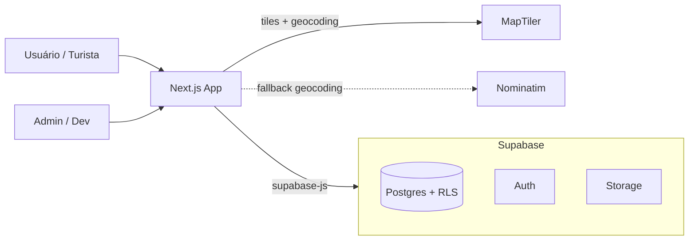
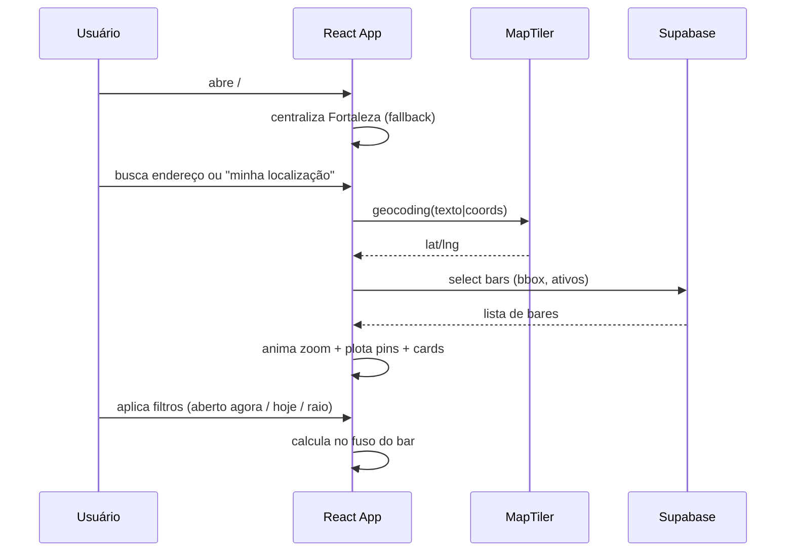

# Arquitetura

> Versão: 0.2 · Base: revisão do `plan.md` v0.1 (ver [`decisions.md`](decisions.md)).

## 1. Visão geral

Aplicação **Next.js 15 (App Router) + TypeScript** que consome diretamente o **Supabase**
(Postgres via PostgREST, Auth e Storage). Não há backend próprio no MVP.



## 2. Camadas

| Camada | Responsabilidade | Tecnologia |
|---|---|---|
| Apresentação | Mapa, cards, filtros, admin | React + MapLibre + i18next |
| Acesso a dados | Query/mutations + auth | `supabase-js` (`src/lib/supabase`) |
| Persistência | Tabelas, integridade, RLS | Supabase Postgres |
| Arquivos | Fotos de bares | Supabase Storage |
| Serviços externos | Tiles e geocoding | MapTiler (fallback Nominatim) |

## 3. Frontend

- **Mapa:** MapLibre GL JS, estilo base MapTiler, centro inicial em Fortaleza.
- **Intro:** Globe.gl apenas na abertura (ou splash estático — ver ADR-002).
- **Estado:** TanStack Query para cache de leitura; estado local/URL para filtros.
- **Rotas:**
  - `/` — mapa público
  - `/bar/:id` — detalhe (opcional no MVP)
  - `/admin` — protegido (login admin)
  - `/privacidade` — política de remoção (PT/EN)
- **i18n:** i18next; `t()` para todos os rótulos; nomes de estabelecimentos não traduzem.

### Fluxo principal (turista)



## 4. Regras de negócio críticas

### 4.1 "Aberto agora" (fuso do bar)

O status é calculado **no fuso do bar** (`America/Fortaleza`), não no do usuário:

```
horaLocalBar = now() convertido para bar_hours.timezone
aberto = algum intervalo de bar_hours do dia cobre horaLocalBar
```

### 4.2 Horário que cruza a meia-noite

Se `closes_at <= opens_at`, o fechamento ocorre no **dia seguinte**.
Ex.: `opens_at=22:00, closes_at=04:00` ⇒ aberto de 22:00 até 04:00 do dia seguinte.

### 4.3 Bar vs. Karaokê

- `bar_hours` = funcionamento do estabelecimento.
- `bar_events` = recorrência do karaokê.
- Se horário do bar e do evento **coincidem** ⇒ UI **unifica**.
- Se **diferem** ⇒ UI mostra dois blocos ("Bar aberto" / "Karaokê rola às…").

## 5. Segurança

- RLS em todas as tabelas expostas.
- Leitura pública: apenas `status='active'` e `opt_out=false`.
- Escrita: somente `authenticated` (conta admin).
- `anon` key no cliente; `service_role` apenas em ambiente seguro.

## 6. Ambientes

| Ambiente | Front | Banco | Dados |
|---|---|---|---|
| Local | `npm run dev` | Supabase (dev) | seed fictício |
| Produção | Vercel/Cloudflare | Supabase (prod) | curadoria real |

## 7. Limites e evolução

- Sem backend próprio ⇒ se surgir lógica privilegiada, usar **Supabase Edge Functions**.
- Scraping não é parte deste diagrama (Fase 4 — ver [`scraping.md`](scraping.md)).
