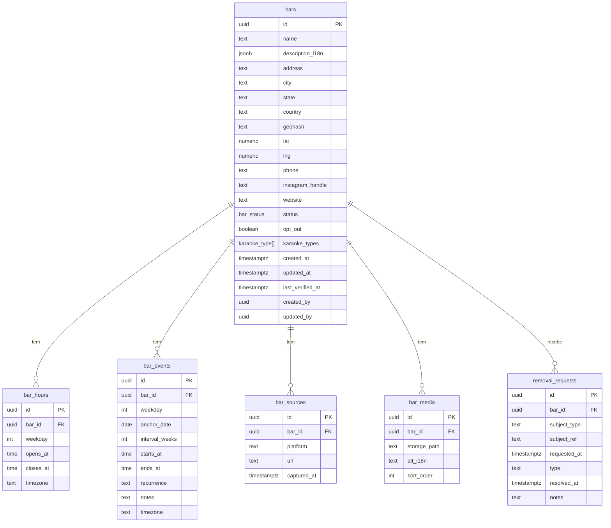

# Modelo de Dados

> Supabase (Postgres). Toda alteração via migration versionada em `supabase/migrations/`.

## 1. ERD



## 2. Enums

```sql
create type bar_status      as enum ('active', 'suspect', 'closed');
create type karaoke_type    as enum ('evento', 'permanente');
create type removal_type    as enum ('full', 'correction', 'opt_out');
create type removal_subject as enum ('bar', 'person');
create type source_platform as enum ('instagram', 'google_maps', 'osm', 'foursquare', 'manual', 'other');
```

## 3. Tabelas

### 3.1 `bars`

| Coluna | Tipo | Notas |
|---|---|---|
| `id` | `uuid` PK | `gen_random_uuid()` |
| `name` | `text` | **Não traduzido** |
| `description_i18n` | `jsonb` | `{"pt":"...","en":"..."}` |
| `address`,`city`,`state` | `text` | `country` default `'BR'` |
| `geohash` | `text` | precisão ~7 para dedup |
| `lat`,`lng` | `numeric` | localização |
| `phone` | `text` | E.164 quando possível |
| `instagram_handle` | `text` | sem `@` |
| `website` | `text` | |
| `status` | `bar_status` | default `'active'` |
| `opt_out` | `boolean` | default `false` |
| `karaoke_types` | `karaoke_type[]` | `['evento','permanente']` |
| `created_at`,`updated_at` | `timestamptz` | default `now()` |
| `last_verified_at` | `timestamptz` | null até 1ª verificação |
| `created_by`,`updated_by` | `uuid` | `auth.uid()` |

### 3.2 `bar_hours`

| Coluna | Tipo | Notas |
|---|---|---|
| `id` | `uuid` PK | |
| `bar_id` | `uuid` FK→bars ON DELETE CASCADE | |
| `weekday` | `smallint` | 0=domingo … 6=sábado |
| `opens_at`,`closes_at` | `time` | se `closes_at <= opens_at` ⇒ cruza meia-noite |
| `timezone` | `text` | default `'America/Fortaleza'` |

**Regra:** múltiplos intervalos por dia são permitidos (mais de uma linha).

### 3.3 `bar_events`

| Coluna | Tipo | Notas |
|---|---|---|
| `id` | `uuid` PK | |
| `bar_id` | `uuid` FK→bars ON DELETE CASCADE | |
| `weekday` | `smallint` | dia da semana do evento |
| `anchor_date` | `date` | referência p/ quinzenal/mensal |
| `interval_weeks` | `smallint` | 1=semanal, 2=quinzenal |
| `starts_at`,`ends_at` | `time` | |
| `recurrence` | `text` | `'weekly'`/`'biweekly'`/`'monthly'` |
| `notes` | `text` | ex.: edições especiais |
| `timezone` | `text` | default `'America/Fortaleza'` |

### 3.4 `bar_sources` (substitui `sources JSONB`)

| Coluna | Tipo | Notas |
|---|---|---|
| `id` | `uuid` PK | |
| `bar_id` | `uuid` FK→bars ON DELETE CASCADE | |
| `platform` | `source_platform` | |
| `url` | `text` | rastreabilidade/auditoria |
| `captured_at` | `timestamptz` | quando a fonte foi vista |

### 3.5 `bar_media`

| Coluna | Tipo | Notas |
|---|---|---|
| `id` | `uuid` PK | |
| `bar_id` | `uuid` FK→bars ON DELETE CASCADE | |
| `storage_path` | `text` | caminho no Storage |
| `alt_i18n` | `jsonb` | texto alternativo por idioma |
| `sort_order` | `int` | ordenação na galeria |

### 3.6 `removal_requests`

| Coluna | Tipo | Notas |
|---|---|---|
| `id` | `uuid` PK | |
| `bar_id` | `uuid` FK **nullable** | nulo quando sujeito é pessoa |
| `subject_type` | `removal_subject` | `bar`/`person` |
| `subject_ref` | `text` | ex.: `@handle`, nome |
| `requested_at` | `timestamptz` | |
| `type` | `removal_type` | `full`/`correction`/`opt_out` |
| `resolved_at` | `timestamptz` | |
| `notes` | `text` | ação tomada + responsável |

## 4. Índices

```sql
create index on bars (status) where opt_out = false;
create index on bars (geohash);
create index on bars using gist (point(lng, lat));   -- se PostGIS disponível
create index on bar_hours (bar_id);
create index on bar_events (bar_id, weekday);
create index on bar_sources (bar_id);
```

## 5. Row Level Security

```sql
alter table bars enable row level security;
-- leitura pública
create policy "public read active" on bars
  for select using (status = 'active' and opt_out = false);
-- escrita admin (autenticado)
create policy "admin write" on bars
  for all to authenticated using (true) with check (true);
```

- Aplicar padrão análogo a `bar_hours`, `bar_events`, `bar_sources`, `bar_media`
  (leitura pública condicionada ao bar visível; escrita só `authenticated`).
- `removal_requests`: **somente** `authenticated` (nunca leitura pública).

## 6. Migrations (ordem inicial)

1. `0001_enums.sql`
2. `0002_bars.sql`
3. `0003_bar_hours.sql`
4. `0004_bar_events.sql`
5. `0005_bar_sources.sql`
6. `0006_bar_media.sql`
7. `0007_removal_requests.sql`
8. `0008_rls_policies.sql`
9. `0009_seed_dev.sql` (apenas dev)

## 7. Pontos de atenção

- **Nunca** guardar `service_role` em migrations.
- Alterações de RLS são **código** e exigem teste (ver [`testing.md`](testing.md)).
- Dedup futuro (Fase 4) usará `geohash` + similaridade de nome — campos já previstos.
