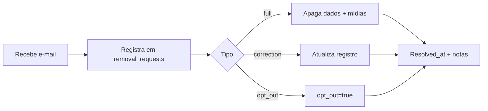

# LGPD e Privacidade

> Rascunho operacional. A política pública deve ser publicada **antes** do primeiro
> dado disponibilizado ao público (gate da Fase 0).

## 1. Base legal

- **Interesse legítimo** (LGPD art. 7º, IX) para dados de **estabelecimentos** e
  informações **públicas** (localização, horário, perfil público em redes sociais).
- Finalidade: informar o público sobre bares com karaokê.
- **Minimização:** coletar apenas o necessário; evitar dados de pessoas físicas.

## 2. Dados tratados

| Categoria | Exemplos | Observação |
|---|---|---|
| Estabelecimento | nome, endereço, horário, telefone, site | dado público |
| Rede social | `@` do perfil do bar | perfil **público** |
| Pessoas | eventual nome de responsável/artista | evitar; tratar sob interesse legítimo |

## 3. Política de Remoção

Qualquer estabelecimento ou pessoa pode solicitar remoção total ou parcial via
e-mail para **[email do dev]**, informando:

- Nome do estabelecimento ou `@` do perfil
- URL no mapa/plataforma
- Tipo de solicitação:
  - [ ] Remoção total
  - [ ] Correção
  - [ ] Oposição ao tratamento

**Prazo de resposta:** 15 dias corridos (LGPD art. 19).

| Tipo | Ação | Prazo |
|---|---|---|
| Remoção total | Apaga do banco e do mapa; sem backup retido | 5 dias úteis |
| Correção | Atualiza o registro | 7 dias úteis |
| Oposição | Marca `opt_out = true`; scraper/coleta ignora | imediato |

**Registro:** toda solicitação fica em `removal_requests` com timestamp, ação
tomada e responsável.

## 4. Fluxo de atendimento

## 5. Avisos no rodapé da aplicação

- Fonte dos dados: coleta manual/curadoria (e, futuramente, automatizada).
- Link para a Política de Remoção (`/privacidade`).
- Contato do responsável (dev) para LGPD.

## 6. Direitos do titular

- Confirmação, acesso, correção, anonimização/bloqueio, eliminação.
- Canal único: **[email do dev]**.
- Registro e rastreio via `removal_requests` (`subject_type`, `subject_ref`, `notes`).

## 7. Retenção

- Dados de bar removidos (`full`) **não** são mantidos.
- `opt_out` persiste apenas para garantir que a coleta ignore o registro.
- Logs de solicitação mantidos para comprovar atendimento (mínimo necessário).

## 8. Roadmap de compliance

- [ ] Publicar política pública em `/privacidade` (PT/EN) — **Fase 0**
- [ ] Definir e-mail/contato oficial — **Fase 0**
- [ ] Formulário/processo de solicitação — **Fase 3**
- [ ] Revisão jurídica antes de qualquer scraping (ver [`scraping.md`](scraping.md)) — **Fase 4**
