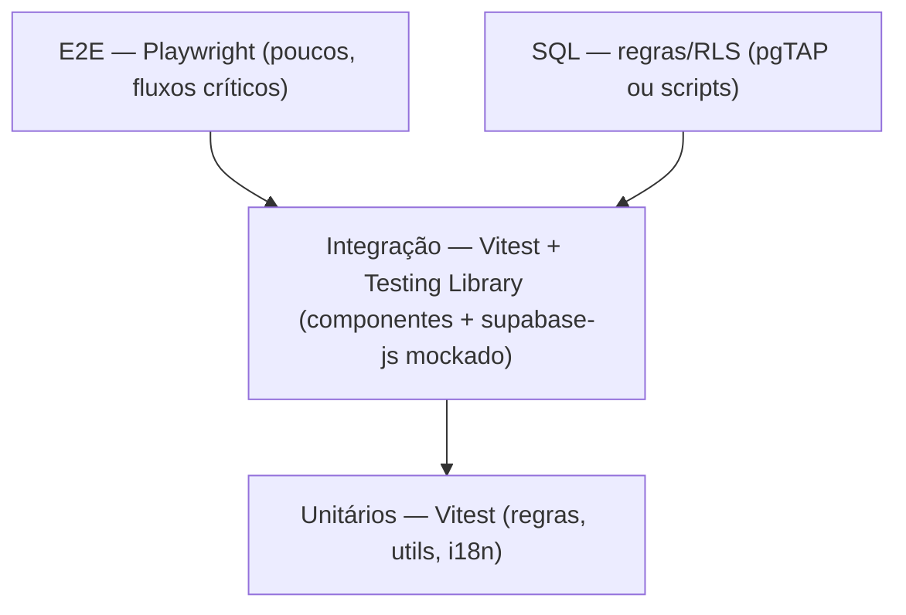

# Estratégia de Testes

## 1. Pirâmide



| Nível | Ferramenta | Cobre |
|---|---|---|
| Unitário | Vitest | funções puras, cálculo de horário, formatação |
| Integração | Vitest + Testing Library | componentes, hooks, fluxo com supabase-js mockado |
| E2E | Playwright | busca → pin → card, admin CRUD, LGPD |
| Banco | script SQL / pgTAP | constraints, overnight, policies RLS |

## 2. Casos críticos (obrigatórios)

### 2.1 Horário que cruza a meia-noite

| Entrada | Agora (fuso do bar) | Esperado |
|---|---|---|
| 22:00–04:00 | 23:30 | **aberto** |
| 22:00–04:00 | 01:30 | **aberto** |
| 22:00–04:00 | 05:00 | fechado |
| 10:00–18:00 | 09:00 | fechado |

### 2.2 Fuso horário

- Usuário em fuso diferente de `America/Fortaleza` → status calculado **no fuso do bar**.
- Evento "hoje" avaliado pela data no fuso do bar.

### 2.3 Bar vs. Karaokê

- Horários coincidem → UI unifica.
- Horários diferem → dois blocos.

### 2.4 Segurança / RLS

- Anônimo **não** lê `opt_out=true` nem `status != 'active'`.
- Anônimo **não** escreve em `bars`.
- Anônimo **não** acessa `removal_requests`.

### 2.5 Deduplicação (Fase 4)

- Mesmo bar em 2 fontes → 1 registro + 2 `bar_sources`.
- Nomes com pequena variação → match por geohash + similaridade.

### 2.6 LGPD

- `type='opt_out'` → `bars.opt_out=true` e bar some do público.
- `type='full'` → registro e mídias removidos.

## 3. Cobertura

- Meta: **≥ 80%** nas funções de regra de negócio (cálculo de horário, fuso, filtros).
- Componentes de UI: cobertura de caminhos principais, não exaustiva.

## 4. Comandos

```bash
npm run test          # Vitest (watch em dev)
npm run test:run      # Vitest one-shot
npm run test:coverage # relatório de cobertura
npm run test:e2e      # Playwright
```

## 5. Dados de teste

- **Fixtures** determinísticas em `tests/fixtures/` (bares fictícios).
- Nunca usar dados reais de produção em testes.
- Banco de teste isolado (Supabase local ou projeto dev).

## 6. CI (GitHub Actions)

```
install → lint → typecheck → test (unit+int) → build → e2e (com banco de teste)
```

PR só entra com todos os checks verdes (ver [`../CONTRIBUTING.md`](../CONTRIBUTING.md)).

## 7. Testes de scraping (Fase 4, futuro)

- Fixtures de HTML capturado + testes de parser (não bater na rede real no CI).
- Alertas de "seletor quebrado" no pipeline.
